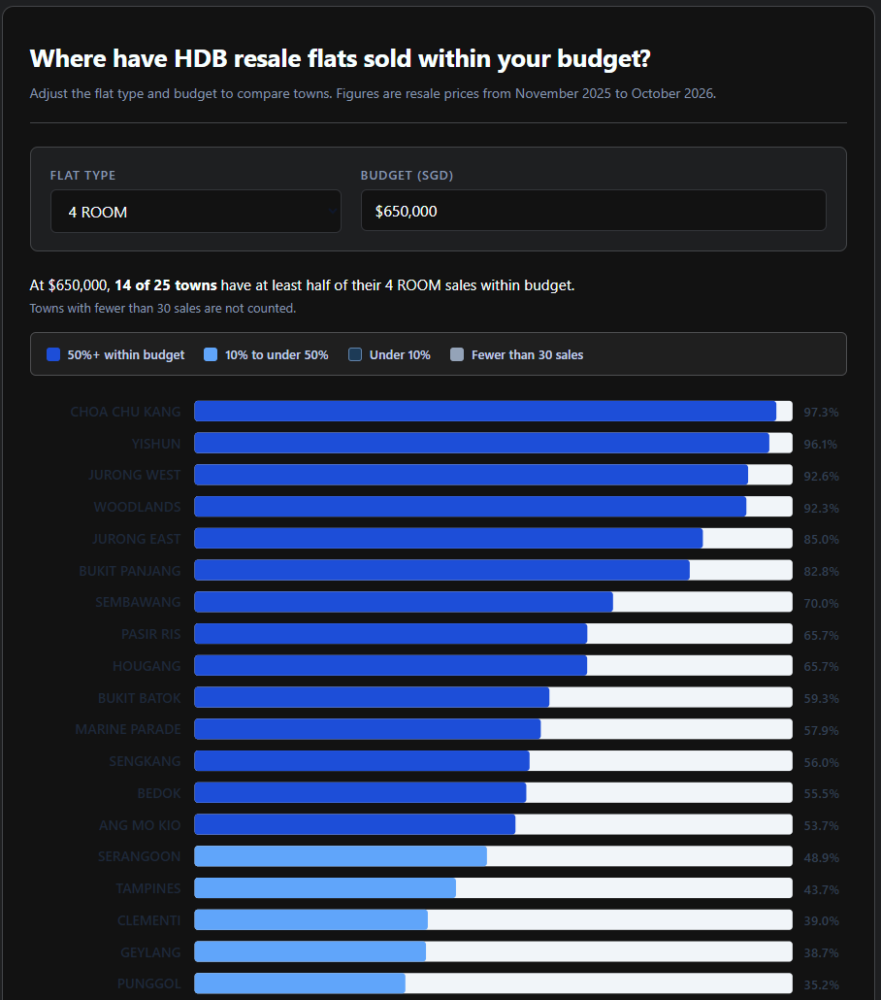

# HDB Resale Budget Dashboard

An interactive dashboard that answers one question for prospective buyers: **where have resale HDB flats sold within my budget?** Choose a flat type and a budget, and the dashboard shows, town by town, the share of resale sales at or below that budget (November 2025 to October 2026).

**[Open the live dashboard](https://isoryan.github.io/hdb-resale-price-dashboard/)**, or download `index.html` and open it in any browser. It is a single file with no installation, and it works offline.

## Audience and purpose

The dashboard is intended for prospective buyers with a fixed budget who are deciding which towns to consider. The aim is to show how often flats sell at or below a given budget, not just what a typical flat costs.

## How to use

1. Choose a flat type (2 ROOM to EXECUTIVE).
2. Enter a budget in SGD.
3. Read the summary sentence above the chart. Towns are ranked by share of sales within budget, and hovering over a bar shows "X of Y sales".

## Key design decisions

- **Share of sales within budget, not average price.** An average describes a typical flat, not what is available at a given budget, and a few expensive sales can pull it up. At $650,000, Ang Mo Kio's average 4 ROOM price is about $735,000, which would rule it out, yet about 54% of its 287 sales in the window were at or below budget.
- **A threshold on the share, not just "any sale".** Counting a town as a candidate because one sale fell within budget is uninformative: at $650,000, all 26 towns have at least one such 4 ROOM sale, but only 14 have at least half. The dashboard therefore highlights towns where at least half of sales are within budget, and shows the exact share for the rest.
- **A single fixed 12-month window (November 2025 to October 2026).** Every town is measured over the same period, and the data stays small enough to embed in one file. The period is stated on the page.
- **Towns with fewer than 30 sales are shown separately and not counted in the headline.** Thin samples can show extreme shares. For 2 ROOM flats, only 8 of 23 towns have 30 or more sales. The threshold of 30 is a common rule of thumb, not a hard rule.
- **Colour bands designed for colour-blind readers.** The three bands (50%+, 10% to under 50%, under 10%) are shades of a single blue that differ in lightness, not hue, so they stay distinguishable under common forms of colour blindness. Colour is never the only cue: every bar carries its percentage label, and towns with fewer than 30 sales are set apart in their own labelled section, not just coloured grey.
- **Flat types: 2 ROOM to EXECUTIVE.** 1 ROOM and MULTI-GENERATION flats were excluded because they have too few sales (89 and 93 across the whole dataset, and 9 each in the window).
- **Default of 4 ROOM at $650,000,** close to the median 4 ROOM price in the window ($630,000, from 11,103 sales).
- **Standalone by design.** All data and code are embedded in one HTML file with no external libraries, fonts or map tiles, so it works offline and can be shared as a single file.
- **Edge cases handled:** empty budget, budget below every sale, and budget above every sale each show a specific message.

## Verification

The figures were checked against independent SQL queries on the same dataset.

- Per-town counts for the default view (for example Choa Chu Kang: 502 of 516 sales, 97.3%).
- The "at or below" boundary, using a budget equal to the cheapest sale.
- Towns with no sales for a flat type (2 ROOM, EXECUTIVE).
- Figures quoted in this README (for example the 4 ROOM median and Ang Mo Kio's average).

The edge-case messages (empty budget, budget below or above every sale) were tested manually with extreme budgets.

## Limitations

- A static snapshot. The data is not refreshed automatically.
- Nominal prices, not adjusted for inflation.
- Each town's sales mix flats of different sizes, storey levels and remaining lease terms.
- The budget is compared with the resale price only, with no allowance for grants, loan limits or renovation.

## Data

Contains information from [Resale flat prices based on registration date from Jan-2017 onwards](https://data.gov.sg/datasets/d_8b84c4ee58e3cfc0ece0d773c8ca6abc/view), accessed on 30 October 2026 from Housing & Development Board (HDB) via data.gov.sg, which is made available under the terms of the [Singapore Open Data Licence version 1.0](https://data.gov.sg/open-data-licence).

## AI assistance

Built with assistance from Claude and Antigravity. The question, design decisions and prompts were the author's own, the AI tools wrote the code under that direction. Numbers were verified independently by the author using SQL.

## Author

Ryan Tan · ryantan5577@gmail.com
